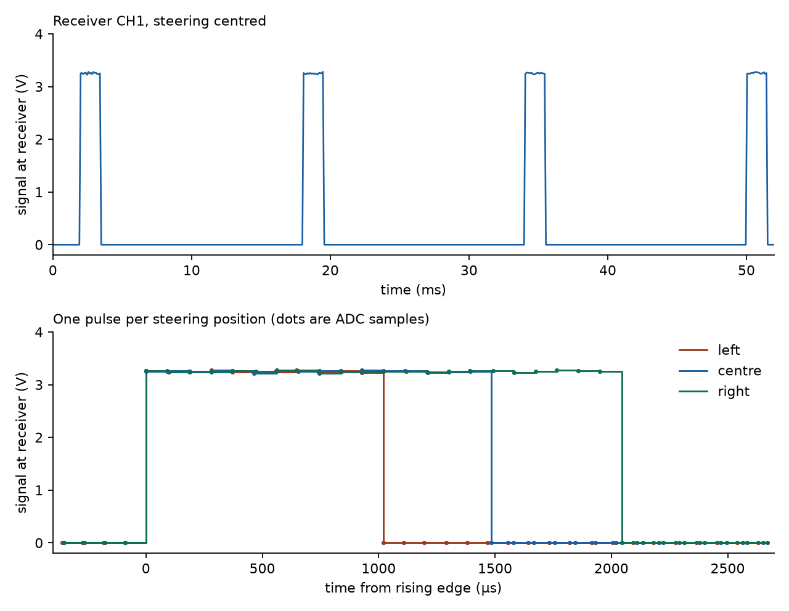

# Receiver probe

What does the RC receiver send to the steering servo: voltage level, frame period and pulse width?

The probe samples one receiver channel with the ADC through a divider and prints, once a second, the peak voltage,
whether the ADC saturated, and the mean, minimum and maximum of the frame period and the pulse width.
Sending `d` dumps the raw samples of the next capture as CSV, for plotting.

## Wiring

The divider keeps the pin safe even if the receiver used 5 V logic. With 1k over 2k the pin sees two thirds
of the signal: 3.3 V becomes 2.2 V and 5 V becomes 3.3 V, which saturates the ADC instead of damaging it.

```
receiver CH1 S ──[1k]──┬── ESP32 GPIO 7
                       │
                     [2k]
                       │
receiver CH1 − ────────┴── ESP32 GND
receiver CH1 +            not connected
```

| From | Breadboard | To |
|---|---|---|
| Receiver CH1 S (white) | a10 | |
| 1 kΩ (brown black red) | c10 to c14 | |
| ESP32 GPIO 7 (yellow) | a14 | |
| 2 kΩ (red black red) | e14 to left blue rail | |
| Receiver CH1 − (grey) | left blue rail | |
| ESP32 GND (brown) | left blue rail | |
| Receiver CH1 + | not connected | |

The servo is unplugged from CH1. The receiver is powered by the ESC's BEC through CH2, and the ESP32 by USB.
Only the grounds are joined.

## Procedure

1. Fix the transmitter: both channels on NOR, trims at 0, steering D/R at maximum.
2. Flash the probe and open the monitor. `monitor_speed` is 921600 in `platformio.ini`.
   ```bash
   pio run -d firmware/tools/receiver_probe -t upload
   pio device monitor -d firmware/tools/receiver_probe -f log2file
   ```
   With the car off the output shows a few mV of noise and `no data`.
3. Transmitter on first, then the car, with the wheels in the air. Do not touch the throttle.
4. Hold the wheel centred, full left and full right in turn. Type `d` at each position to dump a capture.
5. Car off first, then the transmitter. The log stays in `logs/` (ignored by git).

To turn the dumps into the CSV and the figure:
```bash
uv run receiver-signal extract firmware/tools/receiver_probe/logs/<log file>
uv run receiver-signal plot
```

## Reading the output

```
samples=10020, step=89 us (width error +/- 89 us), max=2200 mV, saturation=NO,
period=mean=16017 us, min=15977 us, max=16092 us, n=55, width=mean=1503 us, min=1477 us, max=1585 us, n=56
```

| Field | Meaning |
|---|---|
| step | Time between ADC samples, and so the error of every width |
| max | Peak at the pin. Multiply by 1.5 for the receiver signal |
| saturation | YES means the pin reached the ADC limit, so the signal is 5 V logic |
| period | Time between rising edges. A maximum near 32 ms means one frame was lost |
| width | High time of each pulse. This is the steering command |

## Results

CH1 signal, 16 Nov 2026: 3.3 V logic, 16.0 ms period, 1000 / 1503 / 2031 us for left, centre and right,
and no frame lost in ten minutes at 5 m. See [issue #9](https://github.com/HuguitoH/proprioceptive-stability-rc/issues/9)
and the figure below.


